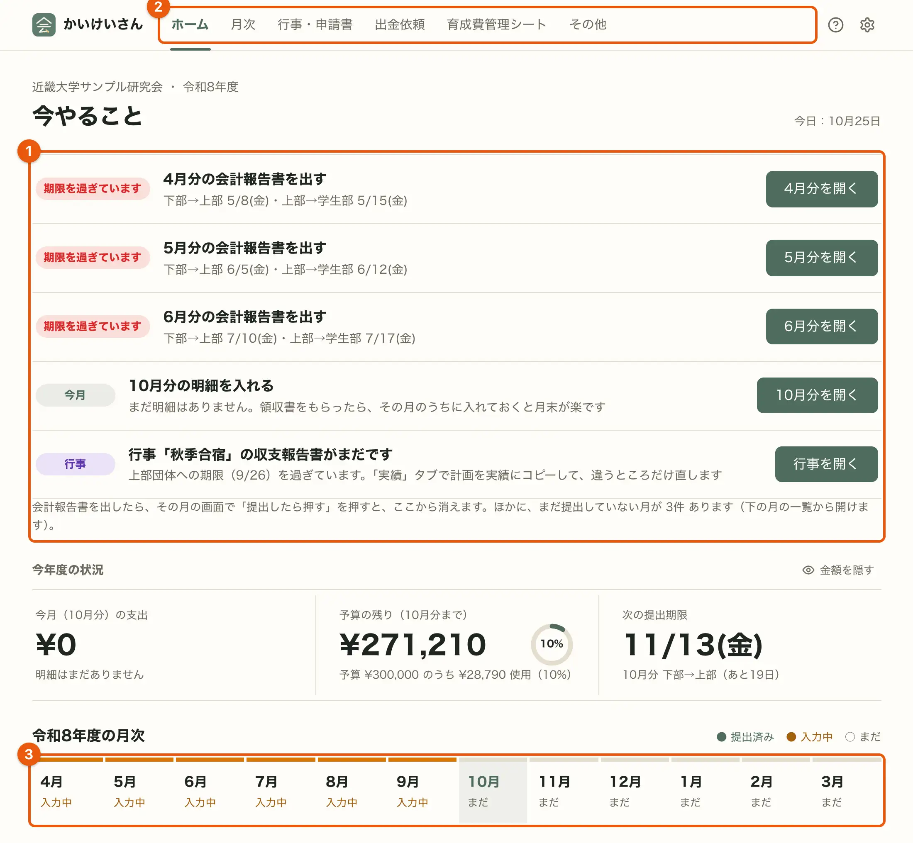
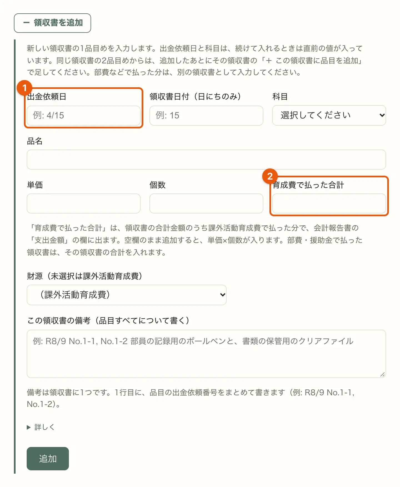
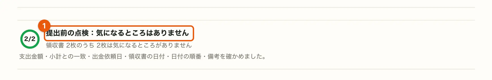
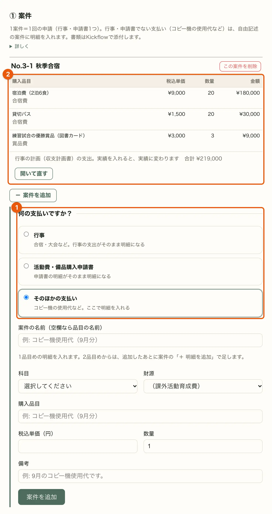

# かいけいさん ― 学生団体の会計書類を自動で作るWebアプリ

近畿大学 情報学部の学生が個人で開発 ／ 2026年9月〜開発中・運用中

> 画面の写真は、すべて架空の団体「近畿大学サンプル研究会」の見本のデータです。実際の団体のお金や個人の情報は載せていません。

---

## 1. なぜ作ったか

私は所属する自治会で会計役員をしています。学生団体は、大学から出る活動のお金（課外活動育成費）を使うたびに、毎月の会計報告書や出金依頼書などを、公式のExcelの様式で出す必要があります。

実際に担当してみると、次のことに困りました。

- **決まりが細かく、間違えやすい**：同じ領収書の品目の並べ方、金額を書く行、科目とお金の出どころの組み合わせなど、要項とマニュアルに細かい決まりがあり、差し戻しの原因になる
- **同じことを何度も書く**：明細をExcelに書き、累計や予算の残りを手で計算し、出金依頼のシステム（Kickflow）にもまた同じ明細を打つ
- **期限や差し戻しに気づくのが遅れる**：提出期限が月ごとに違い、差し戻されても気づかないことがある
- **引き継ぎが難しい**：役員は毎年入れ替わり、やり方が人の頭の中にしか残らない

「会計に詳しくない人でも、迷わず・間違えずに出せる」ことを目標に、一人で設計・開発し、自分と団体の役員で実際に使っています。

## 2. できること

**ホーム「今やること」**：期限が近い・過ぎた書類、まだ出していない出金依頼、差し戻された申請などを、やる順に並べます。ログインしたら次に何をすればよいかが分かる画面にしました。

**明細を入れるだけで書類ができる**：領収書の内容を1件ずつ入れると、公式のExcelと同じ見た目の会計報告書・表紙・予算報告書・貼付用紙を Excel と PDF で出します。行事の収支計画書・収支報告書、各種申請書、学生大会の発表資料など、13種類の書類に対応しています。

**出す前に自動で点検**：要項・マニュアルの決まり（金額と小計の一致、日付の順番、備考の書き方、件数の上限など）をアプリが確かめ、気になるところを知らせます。

**出金依頼システム（Kickflow）とつなぐ**：入れた明細から Kickflow の申請の下書きを作ります。差し戻されたら15分以内に通知で知らせ、差し戻しの理由を画面に出し、明細を直して再申請までできます。

そのほか、提出期限の通知（スマホのホーム画面に追加して使えます）、役員どうしの相談の書き込み、アプリを使う前に作ったExcelの取り込み、全データのバックアップがあります。

## 3. 使う人を中心に考えたこと

使う人は、毎年入れ替わる会計役員です。パソコンに慣れていない人もいます。

- **画面の言葉を「やること」で書く**：「月次」「行事」のような区切りより、「4月分の会計報告書を出す」「10月分の明細を入れる」のように、次の行動が分かる言葉にしました。
- **決まりは要項とマニュアルを根拠にする**：推測で決まりを作らず、資料のページを確かめてから点検の内容を決めています。
- **使ってもらって直す**：実際に使った人から出た困りごとを、小さく何度も直しています。例：
  - 相談の書き込みが送れなかったときに、書いた文が消えてしまう → 消えないようにした
  - 通知を押しても画面が開かないことがある → 直し、アイコンに未読の数を出した
  - スマホで押しにくい・文字が小さい → 下のメニュー・ボタンの大きさ・文字の大きさを見直した
- **だれでも使えるように**：キーボードだけ・画面の読み上げでも使えるようにし、使いやすさの検査（axe-core）を自動のテストに入れています。
- **引き継げるように**：使い方のページ（画面の写真つき）と、次の担当者向けの仕様書（約1,200行）を書き、変えるたびに更新しています。

## 4. 作り方の工夫

| 分野 | 使ったもの |
|---|---|
| 画面・サーバー | Next.js 16・React 19・TypeScript |
| データベース | Turso（SQLite互換） |
| Excel・PDF | Python（公式の様式のセルに書きこむ）、LibreOffice で PDF に変換 |
| 動かす場所 | Vercel |
| 外部との連携 | Kickflow の API、ブラウザの通知（Web Push）、メール |

- **安全**：大学のメールアドレスでの1人ずつのアカウント、パスワードは元に戻せない形で保存、端末ごとのログインの管理、知らない端末からのログインのお知らせ。お金と個人の情報を扱うので、最初に気をつけたところです。
- **壊さないための仕組み**：変更のたびに、型の確かめ・約190件の自動テスト・画面を実際に操作するテスト・見た目の比較を、GitHub で自動で動かしています。
- **小さく出して直す**：2026年9月に作り始めてから約3か月で、200件以上の変更（プルリクエスト）を重ねてきました。

## 5. ふりかえりと、これから

最初は「書類を正しく作る」ことだけを考えていました。ところが使ってもらうと、「いつ・何をすればよいか分からない」ことのほうが大きな困りごとだと分かりました。そこで、機能ごとに分かれていたホームを、期限の近いものから並べる「今やること」の画面に作り直しました。作る側が考えた正しさより、使う人がつまずく場面を見ることが大切だと学びました。

これからは、要項が年度ごとに変わっても、プログラムを直さずに決まりを入れ替えられるようにしたいと考えています。
